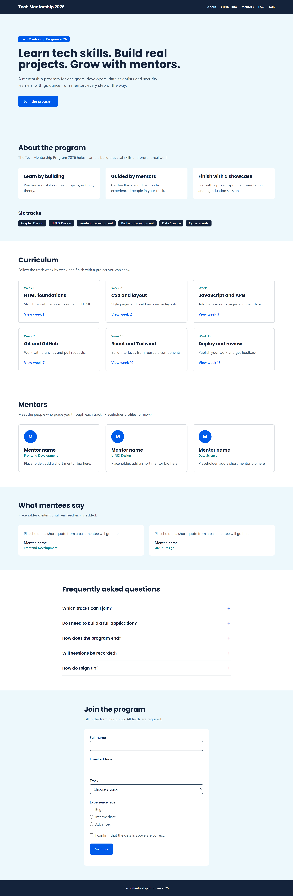

# Tech Mentorship Program 2026: Landing Page

**Chosen option:** C (Landing page for a mentorship or community program)

A responsive landing page for the Tech Mentorship Program 2026. Visitors can read about the program, browse sample curriculum milestones, see the mentor areas, read the FAQ and sign up through an accessible form. It is built with React, React Router and Tailwind CSS. It is a frontend-only project, so the sign-up uses a mock submit.

- **Live site:** https://tech-mentorship-landing.vercel.app/
- **GitHub:** https://github.com/apankadavid/tech-mentorship-landing

## Features
- Sections: Hero, About, Curriculum, Mentors, Testimonials, FAQ and Sign-up
- Sticky, translucent navigation with an accessible mobile menu (opens and closes with the keyboard, Escape closes it)
- Curriculum milestone cards built from a data array and passed to components with props
- Dynamic route `/curriculum/:weekId`, a `/thank-you` route and a 404 page for unknown addresses
- Accessible FAQ accordion that works fully with the keyboard
- Sign-up form with controlled inputs (text, select, radio group, checkbox), validation and four states: idle, submitting, success and error
- Skip link, visible focus outlines and a layout that works from 375px up

## Tech stack
React (Vite), React Router, Tailwind CSS v3, lucide-react icons, deployed on Vercel.
Theme colours and fonts are defined in `tailwind.config.js` under `theme.extend`.

## Setup
```bash
git clone https://github.com/apankadavid/tech-mentorship-landing.git
cd tech-mentorship-landing
npm install
npm run dev      # run locally
npm run build    # production build
```

## Screenshots
| Mobile (375px) | Desktop (1280px) |
|---|---|
|  |  |

## Lighthouse scores (live site)

| Stage | Device | Performance | Accessibility | Best Practices | SEO |
|---|---|---|---|---|---|
| Before fixes | Mobile | 90 | 100 | 100 | 82 |
| Before fixes | Desktop | 93 | 100 | 100 | 82 |
| Final | Mobile | 90 | 100 | 100 | 100 |
| Final | Desktop | 94 | 100 | 100 | 100 |

After the first round of fixes, Performance reached 95 (mobile) and 94 (desktop). After I added photos and more sections in the redesign it dropped to 90 (mobile) and 87 (desktop). Compressing the photos and preloading the hero photo brought desktop back to 94.

**Issues fixed**
- SEO: added a meta description and a clear page title
- SEO: added `public/robots.txt` (the route rewrite was returning the home page for it)
- Performance: lazy-loaded the week detail and thank-you routes so they load only when visited
- Performance: converted photos to WebP, resized them, set width and height on images, and used `loading="lazy"` on images below the first screen
- Performance: preloaded the hero photo
- Accessibility: kept a visible focus outline on every control, including form fields and the mobile menu button
- Accessibility: darker teal for text and buttons so white text meets the 4.5:1 contrast ratio

**Accessibility features built in:** skip link, visible focus styles, labelled form fields with error messages linked to their inputs, keyboard-operable accordion and menu with `aria-expanded`, a success or error message announced in a live region, and focus moved to the heading on the thank-you page.

## Known limitations
- The sign-up form is a mock: nothing is stored or emailed. An email ending in `@fail.test` triggers the error state for testing.
- Mentor names are not announced yet. The mentor cards use illustrated placeholder avatars, and the testimonials are placeholder text.
- Curriculum milestones are sample content, not a confirmed timetable.
- Photos: **[add where the photos came from and that they are used with permission]**

## What I would build next
- Connect the form to a real backend or form service
- Add real mentor profiles with photos and real participant testimonials
- Add a dark mode toggle and automated tests for the form